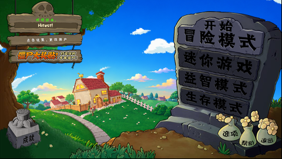
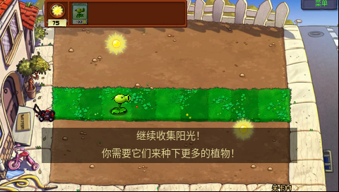
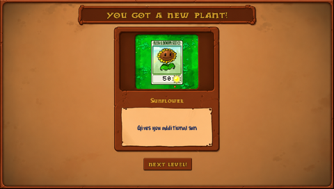
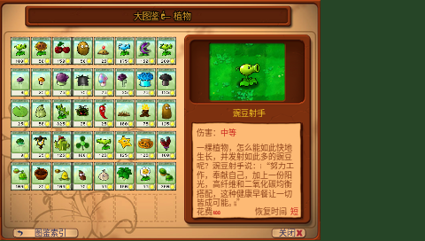

# BBKH1-PVZ

步步高 **H1 / Y100 V1.41** 的《植物大战僵尸》原生 BDA 移植，基于 PvZ-Portable 固定提交 `98b659380014c89c3553fbb2839f5e5a84d6df3d`。480×272 宽屏，保留原版九列草坪、实体与 V4 存档坐标；图片离线适配，原游戏逻辑、菜单和动画源码参与编译。

这是按用户要求建立的私有源码与资源存档。目前没有版本标签或 Release。

## 快速开始

本仓库已包含真机验证过的 `prebuilt/H1PVZPortable.bda` 和完整运行资源，无需转换资源即可安装：

1. 将 `prebuilt/H1PVZPortable.bda` 复制到 **`A:\应用\程序\H1PVZPortable.bda`**。
2. 将 **`private/resources-h1-wide/` 里面的完整目录树**复制到 **`B:\应用\数据\游戏\PVZ\`**；该目录下应直接有 `properties/resources.xml`、`images/`、`reanim/`、`sounds/` 等。
3. 在 H1 桌面启动“植物僵尸”（四字短名称）。游戏创建的 `userdata/` 存档位于同一个 PVZ 资源根目录，更新时保留它。

也支持 `A:\应用\数据\游戏\PVZ\`。程序优先选中 A 盘有效资源根目录，否则选 B 盘；资源与存档整次运行使用同一根目录。要使用 B 盘，应避免 A 盘同时留有旧的有效 PVZ 资源根目录。

触摸直接点击；Enter 对应原版回车，Esc/返回键对应原版返回。H1 不绘制鼠标十字光标，选卡、种植预览照常显示。当前版本已汉化文本与界面图片，中文字体和图片均离线处理。

桌面图标已按 H1 的圆角高光底板和立体边框重新设计，见 [图标及生成提示词](assets/icon.provenance.json)。动画、粒子和轨迹也已在电脑上预编译，H1 优先读取 `.h1d` 数据，避免每次启动重新解析 XML。菜单直接使用展开后的画面，云与草叶作为静态装饰；新用户、按钮和存档流程沿用原逻辑。

可生成完整 A/B 安装包：

```powershell
git submodule update --init sdk
python -m pip install -r requirements-build.txt
python tools/verify_repository.py
python tools/package_install.py
```

安装包输出 `dist/H1PVZ-full-install.zip`，不含个人存档。直接使用仓库成品不需要编译器、SDK 或固件转储。

开发者构建入口：

```powershell
git clone --recurse-submodules https://github.com/HelloClyde/BBKH1-PVZ.git
cd BBKH1-PVZ
python -m pip install -r requirements-build.txt
python tools/install_toolchain.py
python tools/bootstrap_cxx.py --jobs 6
python tools/build_widescreen.py --jobs 6
python tools/package_install.py --bda dist/H1PVZPortable.bda
```

构建前需安装 MSYS2 UCRT64 的 `base-devel` 与 `mingw-w64-ucrt-x86_64-gcc`，详见 [构建说明](docs/BUILDING-STANDALONE.md)。可通过 `--toolchain` 和 `--prefix` 复用已有编译器与已验证 C/C++ 运行库，不依赖旁边的开发工作区。

## 截图

以下两张是 **H1 真机 480×272 截图**：




奖励页为完整游戏的主机运行截图，不作为真机性能证据：





## 依赖

- 使用成品：H1 / Y100 V1.41，完整运行资源；无需额外固件文件或插件。
- SDK：`sdk/` 子模块为 [bbk-h1-bda-sdk](https://github.com/MrDefinition1999/bbk-h1-bda-sdk)，固定提交 **`067fe072477861dfc8949d7b1a55279fb92d2548`**。本机型使用 H1 SDK，没有替换为 9588 SDK。
- 构建：Windows、Python 3.11、Pillow 12.3.0、MSYS2、GNU MIPS GCC 15.2.0，以及按脚本构建的 Newlib 4.6.0.20260123 / libstdc++ 15.2.0。
- 源码内含固定版本 zlib 1.3.1 与 libxmp 核心；上游源码和资源均有 SHA-256 清单。
- 仅重新转换图片/音频时需要 FFmpeg/FFprobe、用户自行安装的 UNMO3；使用已收录运行资源无需这些工具。GPT Image 生成图和提示词位于 `private/widescreen/`。

## 验证

当前中文成品的 BDA 为：

`2a468b33a76daf0a30e15d7fe96522c2878752b9694ffbbaa80933160460bbe1`

当前版本真机资源加载时间由 **92.20 秒降至 30.75 秒**。两个 20 秒菜单窗口分别为 **21.93 FPS、21.75 FPS**，首关旧存档继续场景为 **28.08 FPS**；窗口内没有资源读取、图片重载或内存申请失败。触摸 Menu、B 盘存档写回/读回、返回菜单及退出内存释放已检查。完整主机运行通过旧 V4 存档载入、种植、投射物命中、触摸暂停/恢复、奖励页和下一关。首次进入关卡仍有一次原版预加载等待；未逐项测试全部关卡、模式或高密度战斗。

记录位于 [docs/verification](docs/verification)，本次改动与计时范围见 [启动及桌面更新](docs/H1-STARTUP-20261104.md)。CI 的 `Validate snapshot` 校验 SDK、上游源码、完整资源字节和 BDA 文件格式；它不代表一次新的真机测试或原生编译。

## 资源与许可

- `private/resources-h1-wide/`：完整中文运行资源，3,391 个文件、103,179,028 字节，含 253 份离线动画、粒子和轨迹定义。
- `private/source/`：原始资源输入；`private/widescreen/`：扩图源图与提示词；`private/zh-cn/`：中文图片和文本来源。
- `localization/`：语言基线与文案补充；`assets/fonts/`：重新生成中文字形所需的 Noto 原字体，H1 安装不需要 OTF 文件。
- `provenance/`：运行资源与源素材完整文件校验清单。
- 不含个人 `userdata`、存储卡镜像、固件/NAND、工具链、账户凭据或开发缓存。

移植代码与上游代码的许可、原版素材的权利归属分别见 [NOTICE.md](NOTICE.md)、[LICENSE](LICENSE) 和 [COPYING](COPYING)。本私有仓库收录资源不表示这些资源获得 LGPL 许可或自由再分发授权。

中文覆盖范围、字形检查、旧存档提示转换及重新生成步骤见 [汉化记录](docs/H1-ZH-CN-20261103.md)。

## 感谢

- Zhou Qiankang（wszqkzqk）：[PvZ-Portable](https://github.com/wszqkzqk/PvZ-Portable)、上游实现和原始图标。
- PopCap / Electronic Arts：原版游戏、美术、字体与声音；资源提取整理来源为 [FregD156/PvZ_Assets](https://github.com/FregD156/PvZ_Assets)。
- BBK H1 Native BDA SDK contributors：H1 SDK 与已验证接口。
- Claudio Matsuoka、Hipolito Carraro Jr. 等 libxmp 作者；Jean-loup Gailly、Mark Adler 等 zlib 作者。

保留声明：This product includes portions of the PopCap Games Framework, © 2005-2009 PopCap Games, Inc. All rights reserved.
