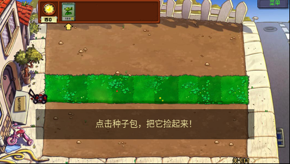
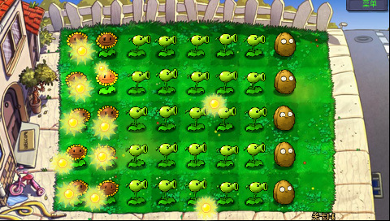

# BBKH1-PVZ

步步高 **H1 / Y100 V1.41** 的《植物大战僵尸》原生 BDA 移植，基于 PvZ-Portable 固定提交 `98b659380014c89c3553fbb2839f5e5a84d6df3d`。480×272 宽屏，保留原版九列草坪、实体与 V4 存档坐标；图片离线适配，原游戏逻辑、菜单和动画源码参与编译。

## 快速开始

本仓库已包含真机验证过的 `prebuilt/H1PVZPortable.bda` 和完整运行资源，无需转换资源即可安装：

1. 将 `prebuilt/H1PVZPortable.bda` 复制到 **`A:\应用\程序\H1PVZPortable.bda`**。
2. 将 **`private/resources-h1-wide/` 里面的完整目录树**复制到 **`B:\应用\数据\游戏\PVZ\`**；该目录下应直接有 `properties/resources.xml`、`images/`、`reanim/`、`sounds/` 等。
3. 在 H1 桌面启动“植物僵尸”（四字短名称）。游戏创建的 `userdata/` 存档位于同一个 PVZ 资源根目录，更新时保留它。

也支持 `A:\应用\数据\游戏\PVZ\`。程序优先选中 A 盘有效资源根目录，否则选 B 盘；资源与存档整次运行使用同一根目录。要使用 B 盘，应避免 A 盘同时留有旧的有效 PVZ 资源根目录。

触摸直接点击；Enter 对应原版回车，Esc/返回键对应原版返回。H1 不绘制鼠标十字光标，选卡、种植预览照常显示。当前版本已汉化文本与界面图片，中文字体和图片均离线处理。

桌面图标已按 H1 的圆角高光底板和立体边框重新设计，见 [图标及生成提示词](assets/icon.provenance.json)。动画、粒子和轨迹也已在电脑上预编译，H1 优先读取 `.h1d` 数据，避免每次启动重新解析 XML。菜单直接使用展开后的画面，云与草叶作为静态装饰；新用户、按钮和存档流程沿用原逻辑。

完整安装包也可从 [Actions](https://github.com/HelloClyde/BBKH1-PVZ/actions/workflows/validate.yml) 的成功运行中下载 `H1PVZ-install-提交号` 制品；版本标签对应的安装包会发布到 [Releases](https://github.com/HelloClyde/BBKH1-PVZ/releases)。下载后解开外层制品，再解压 `H1PVZ-full-install.zip`，按其中 `A/`、`B/` 目录复制。`SHA256SUMS.txt` 用于校验下载文件，安装包不含个人存档。

也可在本机生成完整 A/B 安装包：

```powershell
git submodule update --init sdk
python -m pip install -r requirements-build.txt
python tools/verify_repository.py
python tools/package_install.py
```

安装包输出 `dist/H1PVZ-full-install.zip`，不含个人存档。直接使用仓库成品不需要编译器、SDK 或固件转储。

开发者构建入口：

```powershell
git clone --recurse-submodules https://github.com/HelloClyde/BBKH1-PVZ.git
cd BBKH1-PVZ
python -m pip install -r requirements-build.txt
python tools/install_toolchain.py
python tools/bootstrap_cxx.py --jobs 6
python tools/build_widescreen.py --jobs 6
python tools/package_install.py --bda dist/H1PVZPortable.bda
```

构建前需安装 MSYS2 UCRT64 的 `base-devel` 与 `mingw-w64-ucrt-x86_64-gcc`，详见 [构建说明](docs/BUILDING-STANDALONE.md)。可通过 `--toolchain` 和 `--prefix` 复用已有编译器与已验证 C/C++ 运行库，不依赖旁边的开发工作区。

CI 对主干、PR 和手动运行执行完整性校验、打包、制品上传及下载复验；推送 `vMAJOR.MINOR.PATCH` 标签时自动发布 Release，`-alpha.N`、`-beta.N`、`-rc.N` 后缀会标记为预发布。CI 分发与真机记录匹配的预编译 BDA，不在 runner 上重新编译 C/C++。发布方法见[构建说明](docs/BUILDING-STANDALONE.md#ci-与-release)。

## 截图

以下两张是 **H1 真机 480×272 截图**：


奖励页为完整游戏的主机运行截图，不作为真机性能证据：


## 依赖

- 使用成品：H1 / Y100 V1.41，完整运行资源；无需额外固件文件或插件。
- SDK：`sdk/` 子模块为 [bbk-h1-bda-sdk](https://github.com/MrDefinition1999/bbk-h1-bda-sdk)，固定提交 **`067fe072477861dfc8949d7b1a55279fb92d2548`**。本机型使用 H1 SDK，没有替换为 9588 SDK。
- 构建：Windows、Python 3.11、Pillow 12.3.0、MSYS2、GNU MIPS GCC 15.2.0，以及按脚本构建的 Newlib 4.6.0.20260123 / libstdc++ 15.2.0。
- 源码内含固定版本 zlib 1.3.1 与 libxmp 核心；上游源码和资源均有 SHA-256 清单。
- 仅重新转换图片/音频时需要 FFmpeg/FFprobe、用户自行安装的 UNMO3；使用已收录运行资源无需这些工具。GPT Image 生成图和提示词位于 `private/widescreen/`。

## 验证

当前成品 SHA-256：`abb3d838128a6199f7364b49ae98f514b4ebeb3f05ae3c172a1a03c8ef18417e`。

本版修复全新用户第一关草坪滚动结束后的异常退出。H1 真机完整播放新玩家开场和草坪滚动后正常进入游戏，通过普通触摸种下 3 株豌豆，清除四波僵尸并出现向日葵奖励卡；僵尸、子弹与原游戏计数正常推进，没有写入游戏 RAM 来设置进度或成功状态。

选项、回主菜单和正常退出通过；B 盘原生写出的 **42,856 字节 V4** 已读回核对头、长度和 CRC。退出后用户堆及原生分配记账归零，原用户文件逐字节恢复，测试存档和临时目录已移除，调试器保持运行。原因、回归用例和真机证据见[第一关修复记录](docs/H1-FIRST-LEVEL-CRASH-20261107.md)及[当前真机记录](docs/verification/final-native-verification.json)。



首次新玩家专属开场仍只有约 1～2 FPS，本次修复没有跳过它，也不声称达到整体 20 FPS；部分动态变换仍未完全烘焙，并记录到可恢复的分配失败。

历史性能：上一版 `90c65cdf…d83baf5` 的第六关 40 株植物为 **12.07 FPS**，最初基线为 5.27 FPS；主菜单退出为 **1.80 秒**，最初为 13.05 秒；密集场景选项首次完整画面 575 毫秒，其中暂停快照准备 375 毫秒。这些计时对应[上一版成品记录](docs/verification/history/exit-plants-v33-20261107.json)，本次没有对新程序重新运行该密集场景矩阵。



此前离线动画实现与边界见[缓存生命周期](docs/H1-EXIT-PLANTS-20261107.md)和[当时主机记录](docs/verification/exit-plants-host-verification.json)。第四关、夜间泳池、Loading 文字居中和存档策略的早期验收保存在[历史记录](docs/verification/previous-c90-resource-verification.json)；这些历史结果不冒充本轮重测。

## 资源与许可

- `private/resources-h1-wide/`：完整中文运行资源，2,755 个文件、139,832,497 字节，含 253 份离线定义、20 份字体缓存、标题 PCM、紧凑日间音乐、完整植物离线帧、214 个离线预览、冒险/角色帧与草坪全景。
- `private/resource-build-inputs/`：构建所需的原始定义、音频、字形输入及打包副本，不复制到 H1；完整植物帧用于减少运行时绘制，当前程序与运行资源合计 143,487,069 字节，按当前关卡选择加载。旧版精简记录见 [资源适配与真机记录](docs/H1-RESOURCE-OPTIMIZATION-20261106.md)。
- `private/source/`：原始资源输入；`private/widescreen/`：扩图源图与提示词；`private/zh-cn/`：中文图片和文本来源。
- `localization/`：语言基线与文案补充；`assets/fonts/`：重新生成中文字形所需的 Noto 原字体，H1 安装不需要 OTF 文件。
- `provenance/`：运行资源与源素材完整文件校验清单。
- 不含个人 `userdata`、存储卡镜像、固件/NAND、工具链、账户凭据或开发缓存。

移植代码与上游代码的许可、原版素材的权利归属分别见 [NOTICE.md](NOTICE.md)、[LICENSE](LICENSE) 和 [COPYING](COPYING)。本私有仓库收录资源不表示这些资源获得 LGPL 许可或自由再分发授权。

中文覆盖范围、字形检查、旧存档提示转换及重新生成步骤见 [汉化记录](docs/H1-ZH-CN-20261103.md)。

## 感谢

- Zhou Qiankang（wszqkzqk）：[PvZ-Portable](https://github.com/wszqkzqk/PvZ-Portable)、上游实现和原始图标。
- PopCap / Electronic Arts：原版游戏、美术、字体与声音；资源提取整理来源为 [FregD156/PvZ_Assets](https://github.com/FregD156/PvZ_Assets)。
- BBK H1 Native BDA SDK contributors：H1 SDK 与已验证接口。
- Claudio Matsuoka、Hipolito Carraro Jr. 等 libxmp 作者；Jean-loup Gailly、Mark Adler 等 zlib 作者。

保留声明：This product includes portions of the PopCap Games Framework, © 2005-2009 PopCap Games, Inc. All rights reserved.
