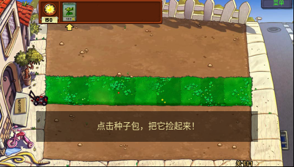
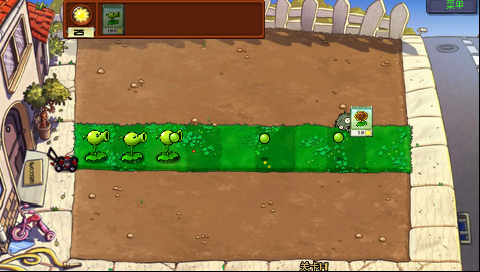

# 第一关开场后的异常退出

## 已复现的问题

H1 / Y100 V1.41 真机、B 盘资源、全新玩家、第一关原始开场流程。已发布 `v0.1.0-beta.1` 的程序 SHA-256 为 `90c65cdf0eb88f491ad53c0d53f890b2de5db63061ae51ccd05cebe19d83baf5`，四处运行时代码指纹一致。

首次开场与草坪滚动之后，运行时阶段变为 `255`、退出码为 `107`，应用返回原生桌面。该退出码同时用于未捕获的非 `bad_alloc` C++ 异常；原生分配记账故障记录为空，不能把本次问题解释为记账溢出。增加不分配内存的异常文本记录后，真机确认异常为 `H1 offline actor bank preload failed`。

## 原因与修复

草坪滚动完成后，`H1ActorPoseFinishSod` 正常释放它的离线像素。随后原版 `LawnApp::StartPlaying` 在场景仍为 `SCENE_LEVEL_INTRO` 时执行预加载，旧逻辑据此再次要求草坪滚动数据。它已经完成且释放，因而触发必需动画包检查失败。

`H1PreloadCurrentBoardForPlay` 现在明确准备正式游戏所需资源，进入正式游戏时不再把已经播放完的草坪滚动作为依赖。开场预加载仍使用原入口，动画继续完整播放，完成后照常释放；没有软件绘制兜底，也没有删去必需资源检查。

运行时另外保留异常类型和最多 255 字节异常文本，写入静态诊断区及已有日志环，无须再分配内存，便于区分缺失资源、解码失败和实际分配错误。

## 验证边界

主机使用完整原游戏回调和真实离线资源验证：先让开场数据退役，再直接调用原始 `StartPlaying`，没有全局缓存重置；正常进入游戏、保留三个活角色状态、释放开场数据，必需包缺失仍拒绝进入。旧回归用例在这两个阶段之间重置了全局缓存，掩盖了自然播放路径的问题，现已去掉该重置。

修复版 SHA-256 为 `abb3d838128a6199f7364b49ae98f514b4ebeb3f05ae3c172a1a03c8ef18417e`。完整构建 189 个编译单元，H1 上传 CRC 和四处运行时代码指纹匹配。真机完整播放开场及草坪滚动后进入第一关，普通触摸种下 3 株豌豆，清除四波僵尸并出现奖励卡；选项、回主菜单和正常退出通过。B 盘写出的 42,856 字节 V4 已读回核对头、长度和 CRC，退出后用户堆和原生分配记账归零。[完整真机记录](verification/first-level-20261107/verification.json)与[主机回归记录](verification/first-level-20261107/host-regression.json)分别标明范围。

原用户目录在测试前改名隔离，`users.dat` 与 `user1.dat` 均读回备份。测试使用单独的新用户；结束后原目录和文件已恢复并逐字节核对，测试 V4 与临时目录已移除，H1 Debug 保持运行。新玩家专属开场仍观察到约 1～2 FPS；这与本次异常退出是两个现象，本次修复不声称已达到整体 20 FPS，也没有重新测速此前的密集场景。

