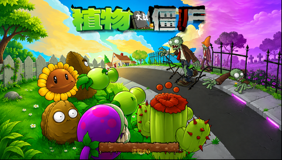

# 冒险模式加载反馈

冒险开场的 450 次更新保留。开场结束、开始读取关卡之前，立即显示复用启动页的加载背景、标题、“读取中”与草皮进度条。草皮按实际预载阶段推进，完成后进入原来的草坪或继续游戏弹窗。加载时直接显示 loading，不更新游戏、不遍历尚未初始化好的草坪组件。

复用画面已由原引擎在电脑上离线生成 480×272 像素。`level-loading.h1ll` 为 361,633 字节，背景与完成态进度条均无损。首次显示直接展开到现有屏幕缓冲，随即释放压缩背景和解码器；预载时仅保留 8,520 字节的草皮补丁，完成时释放。启动页的原图片对象仍按原方式销毁，不在关卡中申请 1060×600 缓冲。菜单预读数据在普通 BDA 退出时由 tracked allocator 统一清理。

此前直接复用图片对象的候选，以及在预载期间保留整份压缩背景的候选均遇到真机内存不足，未作为交付成品。最终改为保留现有屏幕像素，只更新草皮补丁。

主机检查覆盖新开与读档、嵌套加载范围、起始与完成画面的四次原引擎逐像素比较、无游戏更新、加载后显示继续弹窗与清理。真机普通触控验证新开第四关和有效第二关存档：开场动画结束后约 100 毫秒显示加载反馈，并早于关卡读取；两次显示期间分别约 13.1 秒、12.0 秒。上述时间表示这两次实际读取过程，不是加载提速承诺。原第四关的两份用户文件已恢复、设备端 CRC 与读回一致，测试关卡文件已移除。

第四关打开选项/返回菜单的回归仍出现内存不足退出，尚未解决。当前验收限定为加载反馈；既有奖励领取帧率问题也未在本次修复。

[主机检查](verification/level-loading/host.json) · [真机新开](verification/level-loading/fresh-verification.json) · [真机读档](verification/level-loading/saved-verification.json) · [最终专项记录](verification/final-native-verification.json)
