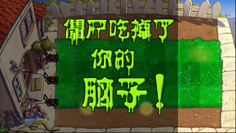

# 失败提示居中

正常冒险失败时，镜头移向房屋后草坪组件的横坐标会变为 220。原动画仍用固定的 `-BOARD_OFFSET` 创建，宽屏显示时没有补偿组件当前的位置，因此文字向左偏约 59 个屏幕像素。

失败动画的根位置改为“宽屏草坪的居中偏移减去草坪组件当前位置”，两条动画创建路径都同步修正。动画、声音、移动镜头和原有计时继续执行。

主机检查调用实际的失败动画构造流程，覆盖草坪横坐标 130、220、-120 与另一条失败分支；动画的原始 800 像素画布统一从逻辑横坐标 130 开始，中心是逻辑 530，即 H1 屏幕横坐标 240。[检查结果](verification/loss-center/host.json)。最终成品 `a50285db` 已通过真机检查：镜头横坐标 220 时截取完整失败动画，提示位于屏幕中心，之后原流程进入结束弹窗、返回菜单并正常退出。测试只把一个活僵尸的位置移到房屋边界外作为前置条件，失败结果与动画计数均由原引擎产生。[原始记录](verification/loss-center/native.json)。

