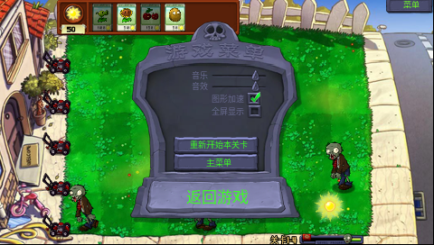
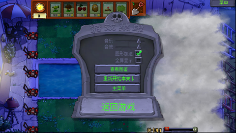

# H1 运行资源精简与剩余离线适配

资源从 134,247,013 字节 / 3,428 文件降至 **85,339,946 字节 / 2,742 文件**，减少 48,907,067 字节（约 36.43%）。图片资源 ID 和逻辑尺寸、游戏存档格式保持不变。完整构建输入留在仓库，安装包只包含运行文件。

同时修正实测热点：打开选项不再无条件驱逐 600 KiB 图片缓存，按真实分配压力回收；水面白色透明光斑改用整数重复采样，保留原动画时间、150 个三角形网格和双线性环绕。通用彩色纹理仍使用原采样器。原水效生成器明确标记白色 RGB、仅透明度变化的纹理，避免每个三角形重复扫描 8,192 个像素确认纹理颜色。

## 离线处理

- 按原 `ResourceManager` 的蓝色通道规则，预先合成 7 类纸条和 2 类夜间水池遮罩，使用预乘透明色进行 Lanczos 缩放；删除运行 XML 的 `alphagrid` 指令，运行时直接读取 RGBA。
- 水池纹理从 721×162 降至 324×73。纸条按原逻辑尺寸的 9/20 密度保存；例如 574×361 降至 258×162。布局和点击区域仍使用原逻辑尺寸。
- 其余 14 份例外素材逐字形、逐粒子帧缩放。小字体选择接近目标密度、且所有非空标点仍占至少一个物理像素的网格；例如 Pico129 为 903×12 → 435×5。粒子帧按照原版整数单元边界独立缩放，不把尾部余数当成额外动画帧。
- 运行目录里，除 1×1 基础像素外，没有原尺寸的独立图片。全景、图集可以大于屏幕，其单元已按 H1 的显示密度处理。

## 清理及来源

移除 695 个旧文件，新增 9 个预合成 RGBA 变体；公共图片包内另删去 2 个不被选择的 RGB 变体。所有 691 个声明图片由完整引擎实际读取和绘制，观察到生产读取路径只使用优先透明版本；据此移除 28 个被透明版本覆盖的 RGB 副本（26 个独立文件、2 个包内条目），保留图片元数据和对应透明版本。清理对象还包括已转换的 OGG/MO3、已有 H1D 的原始动画/粒子定义、没有代码引用的粒子编辑示例、已有 H1FC 的字体文本、构建 JSON/脚本、非宽屏菜单、公共图片包中的独立副本，以及已保存在强制字形块包里的 CJK 整图。

`private/resource-build-inputs/` 保存精简前的构建输入和打包图片的物化版本，拥有完整校验清单，**不放入 H1 安装包**。公共图片仍由原生图片包读取；字形描述保存在 `image-metadata.h1x`，实际字形块由 `font-tiles.h1ft` 读取，保持单一字体文件流。单独的 PCM 保留给延后加载和流式播放路径，不仅因为启动音效包已有副本就删除它们。

构建及校验工具通过 `tools/resource_inputs.py` 读取归档输入。此查找仅适用于本项目生产资源目录，其他测试目录缺文件仍报错，避免归档隐藏测试缺项。

## 验证

- `tools/verify_runtime_resources.py`：核对离线尺寸、逐字形非空映射、归档身份、所有删除项、虚拟图片描述及完整运行目录。
- 完整原游戏的主机测试：30 个资源组、691 项声明图片实际绘制、20 套字体实际绘制、168 项音效读取、144 份注册动画定义加载；字体文本解析回退和字形块错误均为 0。此项是主机测试，不作为真机性能证据。
- 全部 253 份 H1D、公共图片包、字形块包、音效包、离线动画及资源索引仍由仓库校验验证。源文件留在构建输入中，不以删掉来源来跳过校验。

水面主机对照直接调用原游戏 PoolEffectDraw，覆盖日夜、8 个动画时间和 3 个滚动位置，共 48 个完整画面、6,266,880 像素；只有 1,067 个像素出现 1 色阶差异，最大单通道差为 1，动画时间和网格未改动。证据由 `tools/tests/pool_repeat_engine_probe.cpp` 产生。

## 角色烘焙包的无损分页

原 5,882,613 字节角色像素包整体解压常驻约 6.3 MB，加重后期关卡峰值。现将每个 4 KiB 页分别无损压缩，文件为 3,420,204 字节；原始字节及 CRC 全部保持一致。运行时保留压缩数据，采用 32 页（128 KiB）解压缓存和固定解码工作区，读取页不会在动画播放中打开文件或申请解压工作内存。

完整原引擎在仅 2 页缓存的压力条件下通过 180 个整帧对照、12 个屏幕边界案例及 9 个缺失/损坏文件案例；另通过 22,464 组僵尸闪光和 147 组阳光整帧对照。解压字节与原包一致，画面逐像素一致。选卡前不加载无用的整包预览帧；选卡后准备资源时复用现有 Loading 页，早期草坪滚动仍提前准备其烘焙动画。

该封装需配套新程序，安装包校验会拒绝混入其他 BDA。原始角色包保留在构建输入归档中。

## 关卡预加载

真机后期关卡的失败分配来自 `DefinitionAlloc`，并非字体整图展开。旧过场的 `CutScene::PreloadResources` 在当前关卡预热之后，仍会遍历所有解锁植物，加载未选植物的完整动画。H1 已在创建关卡、选卡完成及继续存档前按实际卡槽、模仿类型、敌人波次和奖励预热；移除这一段重复的解锁清单遍历，保留原波次、奖励、对话和挑战脚本依赖。完整引擎测试确认：第 31 关未选坚果保持未加载，选入卡槽后在开局前正确加载，泳池清洁车/水花依赖始终存在。

## 宽屏选卡

补齐手绘开始/随机按钮的父窗口坐标，移除已选卡片重复的横向偏移，并扩大左侧命中区域以覆盖固定在屏幕边缘的卡槽。完整引擎的控件管理器在合法的“面板与卡槽已滑入”前置状态下，实际完成六张卡选择、第一张卡撤下/重选，以及点击可见开始按钮。测试不写入游戏成功结果。

## 存档写入

资源验收期间发现旧 `std::ofstream` 写法会先截断原档，再依赖缓冲写出和析构关闭；泳池退出时出现内存失败及 0 字节的临时测试档，原用户备份未受影响。平台层改用直接描述符写入，关闭后核对长度，再以临时文件和备份完成替换；写入、关闭或替换失败均保留旧数据，读取时可恢复中断替换留下的备份。序列化和存档格式保持原版实现。

`save_file_probe.cpp` 使用真实文件并注入短写、零写、写入/关闭错误、重命名失败和回滚失败，10 个案例通过。完整引擎实际完成档案与第四关 V4 往返读取，连续替换存档后恢复了测试状态，未留下临时文件。

## H1 真机验收

配套程序 SHA-256：`c90cbcf5cfbcdc7eaaf0bb2af9512caf99ec70a19a1549773a03e7fe02e1636b`，3,608,860 字节。程序与资源合计 **88,948,806 字节（88.95 MB）**。设备上的程序上传 CRC、更新资源 CRC、原生代码指纹均通过；其余资源复用完整原生目录清点及后续变更回执。

- 第四关实战安静计时约 **30.91 FPS**。连续三次打开选项首次完整呈现为 **75 / 50 / 50 ms**；原生 40 Hz 计时，分辨率 25 ms。未出现致命内存失败、字体整图请求或字形块读取错误。
- 第三十一关夜间泳池完成原版入场、可见选卡按钮开局、种植向日葵、重复打开选项和保存退出；选项为 **100 / 100 ms**。角色常驻约 4.03 MB，解压缓存峰值 128 KiB，解码错误 0。
- 第四关 V4 存档 49,919 字节，实际继续到原有第三波战况后再次保存 46,604 字节；夜间泳池存档 43,988 字节。各档头、有效负载长度及 CRC 均通过，正常退出后内容未被截断。
- 两次均通过普通菜单退出，返回值 0，游戏堆、原生计费和字体引用归零。原 `user1.dat`、`users.dat` 与测试前逐字节相同，已删除测试 V4；调试器保持运行。
- 冒险的 450 次原版动画更新完整保留，Loading 在重资源预加载前呈现。两次调试输入曾被加载/存档期间的队列拒绝，读取当前状态后改用普通触控节奏继续，未写入游戏进度或成功结果。

**仍有限制：夜间泳池仅约 3.56 FPS，尚未解决其余绘制热点；固件关闭文件仍慢，回菜单/退出保存仍需等待。** 本次不把资源精简称为全关卡达到 20 FPS，也不认证长时间无人值守稳定性。

完整证据见 [真机记录](verification/final-native-verification.json)、[原始观测](verification/20261106-resource-opt/native-observations.json) 和 [主机证据身份](verification/20261106-resource-opt/host-proof-identities.json)。

完整 A/B 盘安装 ZIP：**47,199,285 字节（47.20 MB）**，所有成员均已解包读回核对 SHA-256，不含源文件归档及用户存档。校验见 [安装包记录](verification/20261106-resource-opt/package.json)。
