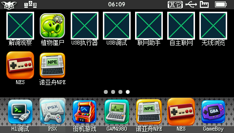

# H1 启动、菜单与桌面入口更新

目标为 H1 / Y100 V1.41，480×272 真机；程序继续使用 `A:\应用\程序\H1PVZPortable.bda`，本次实测资源及存档根目录为 `B:\应用\数据\游戏\PVZ`。

## 桌面入口

桌面名称改为四字的“植物僵尸”。新图标使用 H1 常见的圆角高光底板、立体银边，以豌豆射手和僵尸为主体；内置 imagegen 的提示词与来源保存在 [icon.provenance.json](../assets/icon.provenance.json)。SDK 离线生成 45×45、57×57 及两份 49×60 原生图标资源，运行时无需缩放 PNG。

## 启动与菜单

原版动画、粒子及轨迹 XML 由完整主机运行器提前编译为 253 份 `.h1d`，共 1,246,940 字节。导出采用原版解析器，对每份数据做原始字段、浮点位、字符串和图片/字体名称的往返比较。H1 优先读取预编译数据，旧资源仍可走 XML 兼容路径。

格式按字段序列化，使用字符串表和资源名称，不保存宿主机指针或结构体布局。外层使用 zlib；真机以 4 KiB 页流式读取，两遍完成结构、长度和 CRC 校验及精确数组构建，不保留整份解压副本。返回菜单需要重载 Selector 定义，流式读取避免额外申请 1,493,684 字节的连续临时缓冲。

启动时只预热菜单需要的动画；游戏专用的原版预加载改为首次创建/载入关卡前执行。因此首次进关卡仍有一次预加载等待。加载画面按资源边界至多每秒刷新一次。

H1 直接显示菜单展开后的状态；保留原版 Update 的按钮启用、创建用户、成就与提示逻辑。云和草叶保留为静态装饰，减少菜单重绘。触摸按钮及关卡动画沿用现有逻辑。

## 真机结果

本次最终程序 SHA-256：

`2a468b33a76daf0a30e15d7fe96522c2878752b9694ffbbaa80933160460bbe1`

| 场景 | 实测 |
| --- | ---: |
| 原版本资源加载时间 | 92.20 秒 |
| 新版本资源加载时间 | 30.75 秒 |
| 首次进入主菜单，20 秒窗口 | 21.93 FPS |
| 保存后返回主菜单，20 秒窗口 | 21.75 FPS |
| 首关旧 V4 存档继续，20 秒窗口 | 28.08 FPS |

加载时间使用原来的 `Resource Loading Time` 边界；不包含系统载入 BDA 或用户停留在标题页的时间。原生时钟为 40 Hz，分辨率 25 ms。每个 FPS 窗口有独立的提交帧计数、PC 时间和原生 tick 差值；窗口内没有调试 RPC、输入或截图，三个窗口均无文件打开、图片重载或图片回收。

启动读取 110 份预编译定义；继续关卡并保存返回菜单后累计读取 123 份，无 XML 回退及格式拒绝。真机完成继续存档、选项、保存、返回菜单与正常退出；退出后跟踪的用户堆与原生分配均归零。B 盘存档在退出后读回，检查内部长度、版本和 CRC，并确认内容已变化。

## 验证范围

- 主机：253 份定义原始与压缩往返一致；240 组整帧文本绘制对照；20 个字体、28,320 项中文字形检查；旧存档战斗、暂停、奖励和下一关；保存后重载菜单；新用户对话框。
- 真机：启动、菜单、低密度首关动画、触摸选项、存档写回、菜单重载、退出清理以及桌面短名称和图标。
- 未逐项运行全部关卡、模式及高密度战斗，首关 FPS 不代表所有战斗场景。

完整程序身份、原生代码指纹、窗口计时、存档校验与退出状态见 [final-native-verification.json](verification/final-native-verification.json)。原始结果位于 [verification/startup](verification/startup/)，上一版汉化验收保留在 [历史记录](verification/history/zh-cn-a8-20261103.json)。
